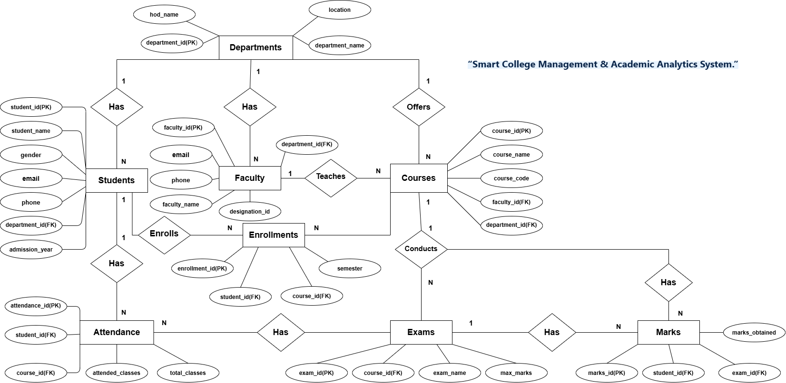

# Smart College Management & Academic Analytics System

A MySQL-based database project designed to manage college academic information, including students, departments, faculty, courses, enrollments, attendance, examinations, and marks.

This project demonstrates relational database design and practical SQL concepts through 8 base tables, sample data, 100 SQL queries, views, stored procedures, a stored function, and triggers.

## Project Overview

The Smart College Management & Academic Analytics System provides a centralized database for organizing college academic records.

It helps retrieve student information, track course enrollments, calculate attendance percentages, analyze examination performance, identify students with low attendance, and generate department-wise academic reports.

The project is developed entirely using MySQL and SQL through the MySQL Command Line Client.

## Features

- **Department Management:** Stores department details and information.
- **Student Management:** Maintains student personal and academic records.
- **Faculty Management:** Stores faculty details and department information.
- **Course Management:** Maintains course details and faculty assignments.
- **Enrollment Tracking:** Records student course enrollments.
- **Attendance Management:** Stores attendance records and calculates attendance percentages.
- **Examination Management:** Maintains examination details.
- **Marks Management:** Stores marks and supports student performance analysis.
- **Academic Analytics:** Generates attendance, marks, and department-wise reports.
- **Data Validation:** Uses triggers to validate marks and attendance records.

## Database Schema

The project uses the `smart_college` database with the following eight main tables:

| Table | Purpose |
|---|---|
| departments | Stores department information |
| students | Stores student details |
| faculty | Stores faculty information |
| courses | Maintains course details |
| enrollments | Records student course enrollments |
| attendance | Maintains attendance records |
| exams | Stores examination information |
| marks | Records student examination marks |

## Relationships

- One department can have multiple students.
- One department can have multiple faculty members.
- One faculty member can be associated with multiple courses.
- One student can enroll in multiple courses.
- One course can have multiple student enrollments.
- Students can have multiple attendance records.
- One course can have multiple examinations.
- One student can have multiple examination marks.

See the ER diagram in the repository for the entities, attributes, keys, and relationships.
## ER Diagram



## SQL Concepts Demonstrated

- Database and table creation
- Primary Keys and Foreign Keys
- NOT NULL, UNIQUE, DEFAULT and CHECK constraints
- INSERT, UPDATE and DELETE operations
- SELECT statements and filtering
- INNER JOIN and LEFT JOIN
- Aggregate functions: COUNT, SUM, AVG, MIN and MAX
- GROUP BY and HAVING
- Subqueries
- ORDER BY and LIMIT
- Views
- Stored Procedures
- Stored Functions
- Triggers
- Transactions: SAVEPOINT, ROLLBACK and COMMIT

## Technologies Used

- **Database:** MySQL
- **Language:** SQL
- **Interface:** MySQL Command Line Client
- **Database Name:** smart_college

## Project Implementation

| Component | Count |
|---|---:|
| Base Tables | 8 |
| Views | 3 |
| Stored Procedures | 7 |
| Stored Functions | 1 |
| Triggers | 4 |
| SQL Queries | 100 |

## Views

The project contains three views:

| View | Purpose |
|---|---|
| attendance_analytics | Displays attendance details and percentages |
| student_performance | Provides student academic performance information |
| department_summary | Displays department-wise academic summaries |

## Stored Procedures

The project includes seven stored procedures:

| Procedure | Purpose |
|---|---|
| sp_all_students | Displays all student records |
| sp_students_by_department | Retrieves students by department |
| sp_student_marks | Displays marks of a particular student |
| sp_course_faculty | Retrieves faculty details for courses |
| sp_student_attendance | Displays student attendance details |
| sp_low_attendance | Identifies students with low attendance |
| sp_department_student_count | Displays department-wise student counts |

## Stored Function

| Function | Purpose |
|---|---|
| fn_student_attendance | Calculates the attendance percentage of a student |

## Triggers

The project contains four triggers:

- `trg_check_marks` – Validates marks before inserting a record.
- `trg_check_marks_update` – Validates marks before updating a record.
- `trg_check_attendance` – Validates attendance before inserting a record.
- `trg_check_attendance_update` – Validates attendance before updating a record.

These triggers help maintain data accuracy by preventing invalid marks and attendance values.

## SQL Queries

The project contains 100 SQL queries organized into three levels:

- **Simple Queries:** Basic SELECT statements, filtering, sorting, and aggregate functions.
- **Medium Queries:** Joins, GROUP BY, HAVING, and subqueries.
- **Advanced Queries:** Complex joins, nested queries, and analytical operations.

## Project Files

```text
Smart-College-Management-System/
│
├── README.md
├── DataBase_Creation_Insertion.sql
├── Simple_Queries.txt
├── Medium_Queries.txt
├── Hard_Queries.txt
├── ER_Diagram.png
├── Smart_College_DBMS_Presentation_Redesigned.pptx
│
└── screenshots/
```

*The ER diagram and screenshots should be uploaded separately. Update their filenames if they differ from the names shown above.*

## Getting Started

### Prerequisites

- MySQL Server 8.0 or a compatible version
- MySQL Command Line Client or another MySQL-compatible SQL client

### Installation and Setup

1. Clone or download this repository.
2. Open MySQL Command Line Client.
3. Connect to your MySQL server.
4. Open `DataBase_Creation_Insertion.sql`.
5. Execute the SQL statements from top to bottom.
6. Select the `smart_college` database.
7. Execute the simple, medium, and advanced query files to explore the project.
8. Test the views, stored procedures, function, and triggers.

**Important:** Check the SQL script before execution. If it contains `DROP DATABASE IF EXISTS smart_college;`, it will delete and recreate an existing database with that name. Back up important data first.

## Explore the Database

After executing the project, try these queries:

```sql
USE smart_college;

-- Display all students
SELECT * FROM students;

-- Display all departments
SELECT * FROM departments;

-- Display all faculty
SELECT * FROM faculty;

-- Display all courses
SELECT * FROM courses;

-- View attendance analytics
SELECT * FROM attendance_analytics;

-- View student performance
SELECT * FROM student_performance;

-- View department summary
SELECT * FROM department_summary;

-- Find students with attendance above 85%
SELECT *
FROM attendance_analytics
WHERE attendance_percentage > 85;
```

## Results

- Successfully created the `smart_college` database.
- Implemented eight relational database tables.
- Created three views for academic reporting.
- Developed seven stored procedures and one stored function.
- Implemented four triggers for data validation.
- Executed 100 SQL queries.
- Generated student performance, attendance, and department-wise analytics.

## Limitations and Future Improvements

- Develop a web-based or desktop user interface.
- Introduce role-based access for students, faculty, and administrators.
- Integrate real-time attendance management.
- Generate automated academic reports.
- Expand the database with more semesters and examination records.
- Develop dashboards using the existing academic views.

*These are planned enhancements and are not part of the current MySQL-only implementation.*

## Author

**Akula Durga Bhavani**

